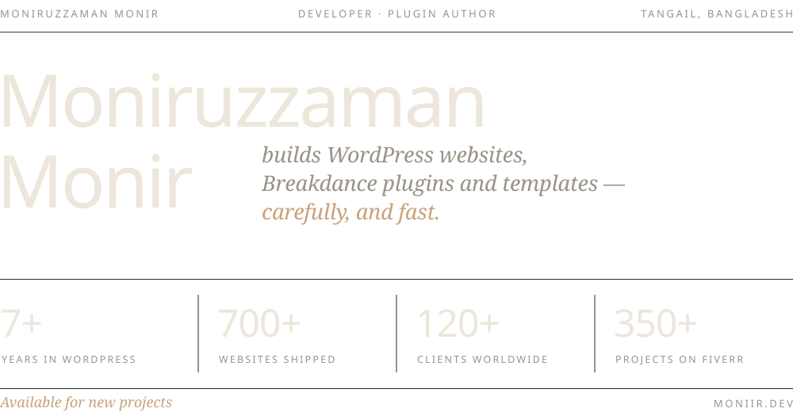
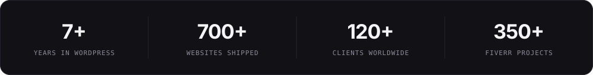
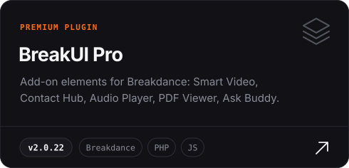
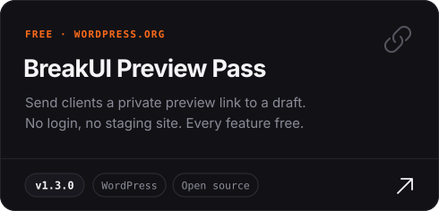
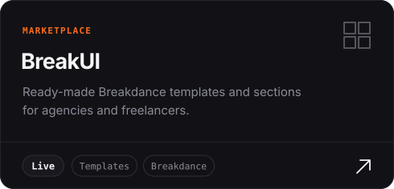
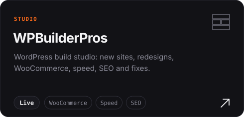
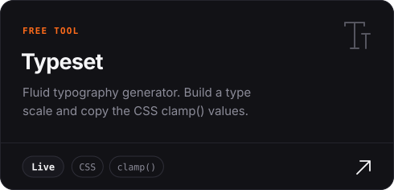
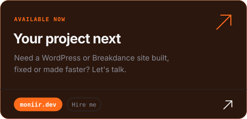
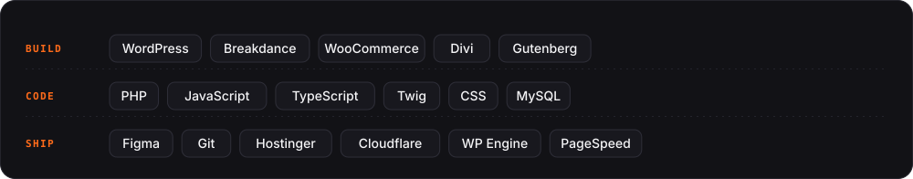
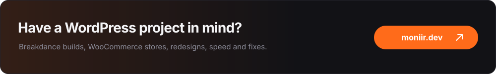

<!-- Artwork is generated by .github/scripts/build.py — edit data there, not the SVGs. -->

  <a href="https://moniir.dev"><picture><source media="(prefers-color-scheme: dark)" srcset="./assets/hero-dark.svg"><source media="(prefers-color-scheme: light)" srcset="./assets/hero-light.svg"></picture></a>

  <a href="https://moniir.dev"><b>moniir.dev</b></a> &nbsp;·&nbsp;
  <a href="https://breakui.com">BreakUI</a> &nbsp;·&nbsp;
  <a href="https://pro.breakui.com">BreakUI Pro</a> &nbsp;·&nbsp;
  <a href="https://wpbuilderpros.com">WPBuilderPros</a> &nbsp;·&nbsp;
  <a href="https://profiles.wordpress.org/monir1999/">WordPress.org</a> &nbsp;·&nbsp;
  <a href="https://www.fiverr.com/sellers/developermonir5/">Fiverr</a> &nbsp;·&nbsp;
  <a href="https://x.com/developermonir5">X</a>

 

  <picture><source media="(prefers-color-scheme: dark)" srcset="./assets/stats-dark.svg"><source media="(prefers-color-scheme: light)" srcset="./assets/stats-light.svg"></picture>

 

<picture><source media="(prefers-color-scheme: dark)" srcset="./assets/label-work-dark.svg"><source media="(prefers-color-scheme: light)" srcset="./assets/label-work-light.svg"></picture>

  <a href="https://pro.breakui.com"><picture><source media="(prefers-color-scheme: dark)" srcset="./assets/card-breakui-pro-dark.svg"><source media="(prefers-color-scheme: light)" srcset="./assets/card-breakui-pro-light.svg"></picture></a>
  <a href="https://github.com/Developermonir/breakui-preview-pass"><picture><source media="(prefers-color-scheme: dark)" srcset="./assets/card-preview-pass-dark.svg"><source media="(prefers-color-scheme: light)" srcset="./assets/card-preview-pass-light.svg"></picture></a>

  <a href="https://breakui.com"><picture><source media="(prefers-color-scheme: dark)" srcset="./assets/card-breakui-dark.svg"><source media="(prefers-color-scheme: light)" srcset="./assets/card-breakui-light.svg"></picture></a>
  <a href="https://wpbuilderpros.com"><picture><source media="(prefers-color-scheme: dark)" srcset="./assets/card-wpbuilderpros-dark.svg"><source media="(prefers-color-scheme: light)" srcset="./assets/card-wpbuilderpros-light.svg"></picture></a>

  <a href="https://fonts.moniir.dev"><picture><source media="(prefers-color-scheme: dark)" srcset="./assets/card-typeset-dark.svg"><source media="(prefers-color-scheme: light)" srcset="./assets/card-typeset-light.svg"></picture></a>
  <a href="https://moniir.dev"><picture><source media="(prefers-color-scheme: dark)" srcset="./assets/card-hire-dark.svg"><source media="(prefers-color-scheme: light)" srcset="./assets/card-hire-light.svg"></picture></a>

 

<picture><source media="(prefers-color-scheme: dark)" srcset="./assets/label-stack-dark.svg"><source media="(prefers-color-scheme: light)" srcset="./assets/label-stack-light.svg"></picture>

  <picture><source media="(prefers-color-scheme: dark)" srcset="./assets/stack-dark.svg"><source media="(prefers-color-scheme: light)" srcset="./assets/stack-light.svg"></picture>

 

<picture><source media="(prefers-color-scheme: dark)" srcset="./assets/label-contact-dark.svg"><source media="(prefers-color-scheme: light)" srcset="./assets/label-contact-light.svg"></picture>

  <a href="https://moniir.dev"><picture><source media="(prefers-color-scheme: dark)" srcset="./assets/footer-dark.svg"><source media="(prefers-color-scheme: light)" srcset="./assets/footer-light.svg"></picture></a>

Versions on the cards update automatically every day.

