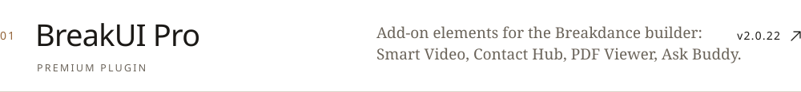
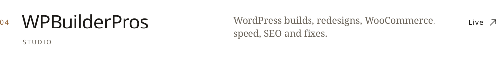
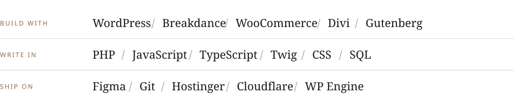

<!-- Artwork is generated by .github/scripts/build.py. Edit the data there, not the SVGs. -->

<a href="https://moniir.dev"><picture><source media="(prefers-color-scheme: dark)" srcset="./assets/hero-dark.svg"><source media="(prefers-color-scheme: light)" srcset="./assets/hero-light.svg"></picture></a>

  

<picture><source media="(prefers-color-scheme: dark)" srcset="./assets/section-work-dark.svg"><source media="(prefers-color-scheme: light)" srcset="./assets/section-work-light.svg"></picture>
<a href="https://pro.breakui.com"><picture><source media="(prefers-color-scheme: dark)" srcset="./assets/work-breakui-pro-dark.svg"><source media="(prefers-color-scheme: light)" srcset="./assets/work-breakui-pro-light.svg"></picture></a>
<a href="https://github.com/Developermonir/breakui-preview-pass"><picture><source media="(prefers-color-scheme: dark)" srcset="./assets/work-preview-pass-dark.svg"><source media="(prefers-color-scheme: light)" srcset="./assets/work-preview-pass-light.svg"></picture></a>
<a href="https://breakui.com"><picture><source media="(prefers-color-scheme: dark)" srcset="./assets/work-breakui-dark.svg"><source media="(prefers-color-scheme: light)" srcset="./assets/work-breakui-light.svg"></picture></a>
<a href="https://wpbuilderpros.com"><picture><source media="(prefers-color-scheme: dark)" srcset="./assets/work-wpbuilderpros-dark.svg"><source media="(prefers-color-scheme: light)" srcset="./assets/work-wpbuilderpros-light.svg"></picture></a>
<a href="https://fonts.moniir.dev"><picture><source media="(prefers-color-scheme: dark)" srcset="./assets/work-typeset-dark.svg"><source media="(prefers-color-scheme: light)" srcset="./assets/work-typeset-light.svg"></picture></a>

  

<picture><source media="(prefers-color-scheme: dark)" srcset="./assets/section-toolkit-dark.svg"><source media="(prefers-color-scheme: light)" srcset="./assets/section-toolkit-light.svg"></picture>
<picture><source media="(prefers-color-scheme: dark)" srcset="./assets/toolkit-dark.svg"><source media="(prefers-color-scheme: light)" srcset="./assets/toolkit-light.svg"></picture>

  

<picture><source media="(prefers-color-scheme: dark)" srcset="./assets/section-contact-dark.svg"><source media="(prefers-color-scheme: light)" srcset="./assets/section-contact-light.svg"></picture>
<a href="https://moniir.dev"><picture><source media="(prefers-color-scheme: dark)" srcset="./assets/footer-dark.svg"><source media="(prefers-color-scheme: light)" srcset="./assets/footer-light.svg"></picture></a>

<a href="https://moniir.dev">moniir.dev</a> &nbsp;·&nbsp;
<a href="https://profiles.wordpress.org/monir1999/">WordPress.org</a> &nbsp;·&nbsp;
<a href="https://www.fiverr.com/sellers/developermonir5/">Fiverr</a> &nbsp;·&nbsp;
<a href="https://x.com/developermonir5">X</a>

